# Лаба 1 - Свой Docker

Я презренный пользователь Windows, так что вся лаба делалась на ВМ: VirtualBox, Ubuntu Server 24.04, 10 ГБ RAM, 12 CPU.

## Часть 0 - сервис
С помощью ИИ сгенерил сервис на FastAPI с тремя эндпоинтами: /health, /eat?mb=N, /burn. /eat выделяет N мегабайт и
держит их до конца процесса, /burn грузит одно ядро в бесконечном цикле.

Создал venv и поставил зависимости:

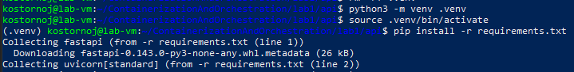

## Часть 1 - запуск напрямую
Запускаю uvicorn, сразу видно PID 5916:

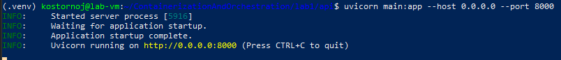

В браузере с хоста открываю health, отвечает "ok":

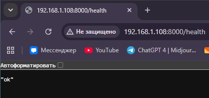

В ps процесс виден как обычный хостовый без изоляции, все неймспейсы общие с systemd:

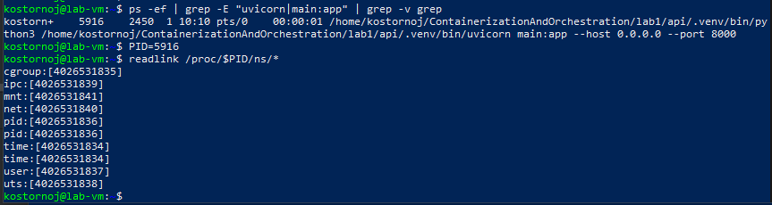

Чтобы убедиться посмотрел lsns, везде NPROCS 250+, то есть делит с другими процессами:

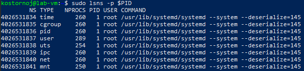

## Часть 2 - namespaces

Запускаю сервис через unshare со всеми нужными неймспейсами и флагами --fork, --mount-proc. Изнутри свой hostname,
uid=0, процессов только два (bash как PID 1 и ps), чужих не видно:

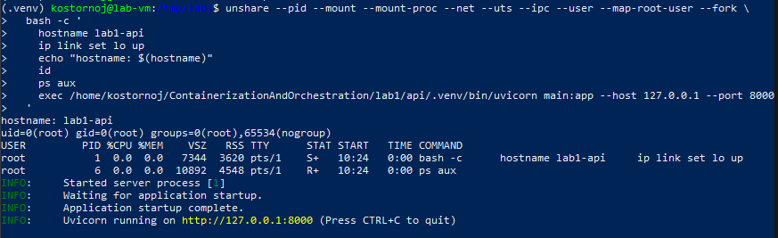

Изолировал шесть namespace: user (uid/gid), pid (дерево процессов), mount (точки монтирования), net (сетевой стек),
uts (hostname), ipc (shared memory и семафоры). Снаружи вижу, что тот же процесс работает под UID 1000,
хотя внутри считает себя root, а lsns показывает новые inode, все шесть namespace свои.

cgroup и time остались общие с хостом, их через unshare не изолируешь:

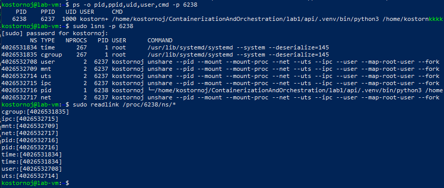

## Часть 3 - cgroups

Завёл директорию lab1 для cgroup для моего сервиса, дальше пишу лимиты в файлы внутри неё.
Перезапускаю uvicorn в фоне, чтобы получить новый PID для дальнейших тестов:

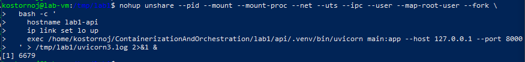

Проверяю, что процесс привязан к новой cgroup и вижу свои неймспейсы:

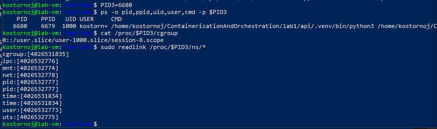

### Память

Ставлю лимит 128 МБ и проверяю, что он лёг:

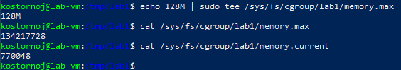

Дёргаю /eat?mb=256. Curl отвалился с exit code 52, uvicorn умер:

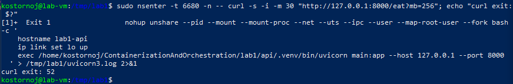

Смотрю события cgroup, oom-kill отработал:

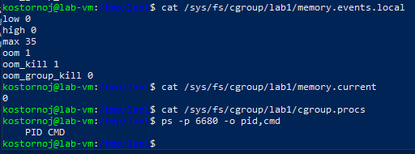

И подтверждение в логах ядра, что kill был именно из-за лимита cgroup, а не из-за глобальной нехватки памяти.

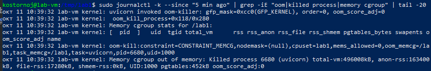

### CPU

Перезапускаю uvicorn:

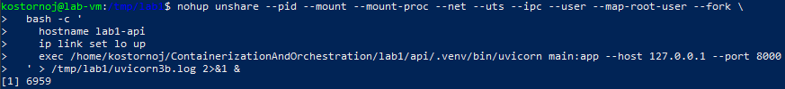

Смотрю статистику cgroup до нагрузки и устанавливаю cpu.max:

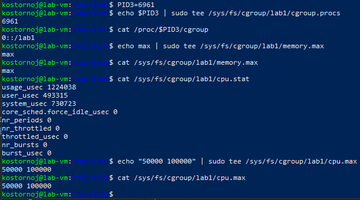

Запускаю /burn в фоне и сразу смотрю cpu.stat. Контейнер 49 раз исчерпал квоту:

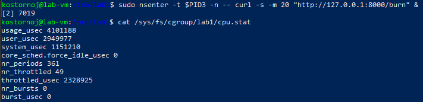

### PIDs

Задаю pids.max = 32. Сейчас в cgroup 6 процессов:

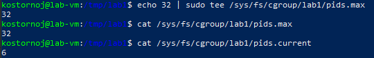

Запускаю форк-бомбу через stress-ng --fork 100. Также была проблема, что процессы, запущенные через nsenter снаружи,
попадают в cgroup того, кто их запустил, а не в целевую, и пришлось запускать через bash -c,
который сам себя кладёт в cgroup, а потом exec заменяет его на stress-ng.

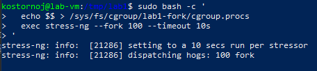

197 тысяч попыток форкнуться упёрлись в лимит. Stress-ng не смог нормально завершиться, прибил через cgroup.kill:

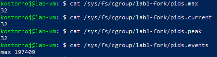

## Часть 4 - права

### Capabilities

Сбрасываю все capabilities через setpriv и проверяю, что mount больше не проходит, хотя uid=0.
Для сравнения тот же дамп от настоящего root:

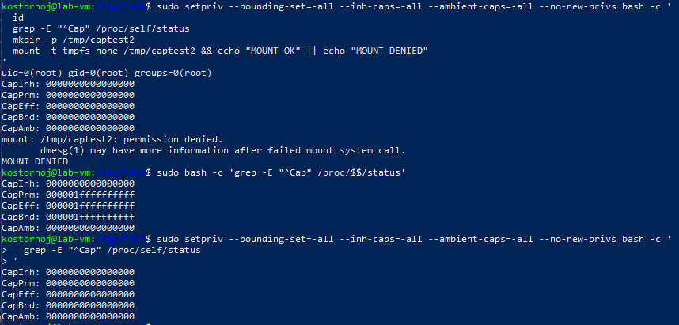

### seccomp

Написал seccomp_runner.py по умолчанию allow всё, конкретный syscall возвращает EPERM.
Проверяю на mkdir и uname оба получают Operation not permitted:

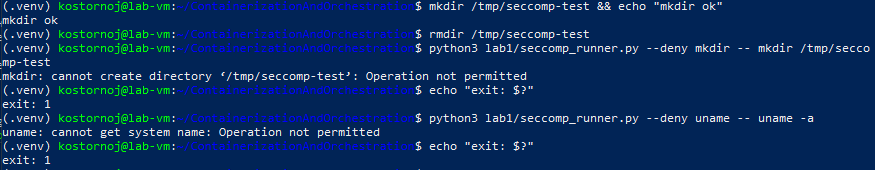

Capabilities режут привилегированные операции по категориям, seccomp конкретные syscalls независимо от прав.

## Часть 5 - свой Docker

Собрал mydocker.sh: cgroup + лимиты + unshare + setpriv + seccomp.
Одной командой поднимает api в своих namespace'ах с лимитами и урезанными правами.

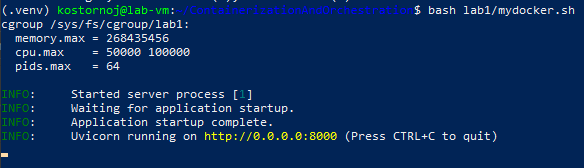

Проверяю снаружи, процесс в cgroup, seccomp активен, /health отвечает изнутри namespace:

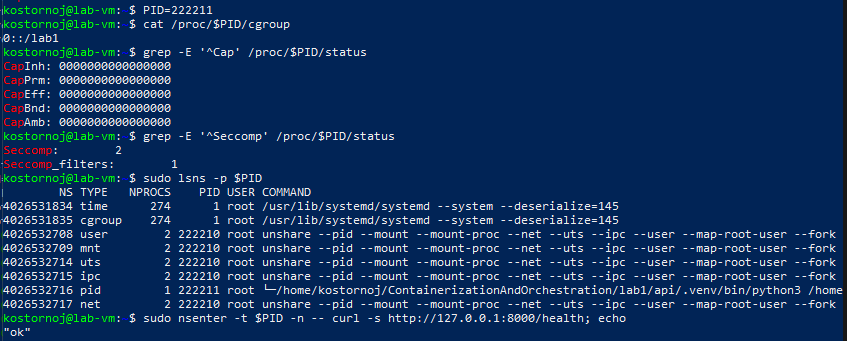

### Сравнение с docker run

Запускаю тот же образ через Docker с теми же лимитами:

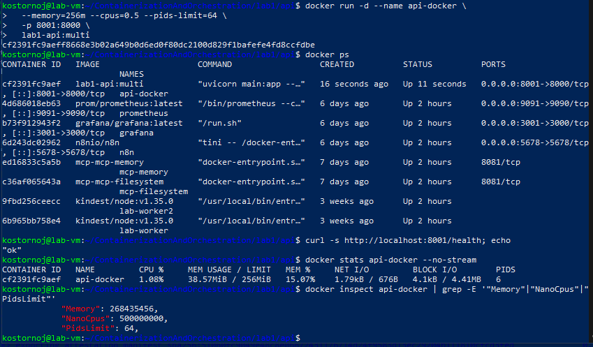

docker inspect показывает ровно те же цифры, что писал руками.

| Что            | mydocker.sh                   | docker run               |
|----------------|-------------------------------|--------------------------|
| Namespaces     | вручную unshare               | встроено (runc)          |
| cgroup: память | echo 256M > memory.max        | --memory=256m            |
| cgroup: CPU    | echo "50000 100000" > cpu.max | --cpus=0.5               |
| cgroup: pids   | echo 64 > pids.max            | --pids-limit=64          |
| Capabilities   | setpriv --bounding-set=-all   | дефолт + --cap-drop      |
| Seccomp        | свой профиль                  | дефолтный профиль Docker |
| Rootfs         | хостовый                      | layered image            |
| Слои образа    | нет                           | есть                     |
| Тома           | нет                           | -v                       |
| Сеть           | своя lo, наружу ничего        | veth + bridge + NAT      |
| Проброс портов | нет                           | -p                       |
| Логи           | stdout в терминал             | json-file + docker logs  |
| Управление     | руками                        | start/stop/rm/exec       |
| Реестр         | нет                           | есть                     |

Главное отличие - файловая система. Скрипт запускает uvicorn из хостового rootfs. Docker даёт свой rootfs из образа,
что делает контейнер воспроизводимым на любой машине.

## Часть 6 - образы

Два Dockerfile в репе: простой Dockerfile.simple и multi-stage Dockerfile. Собираю оба образа:

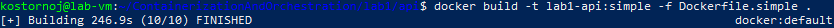
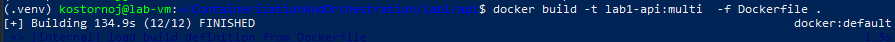

Далее посмотрел размеры:

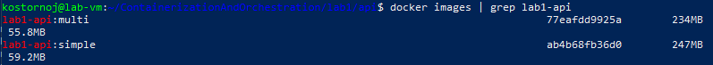

Разница около 13мб. Предполагаю, что из-за того, что в simple pip install затянул за собой pip-кэш,
а в multi только сами пакеты.

Сравнил слои обоих образов через history:

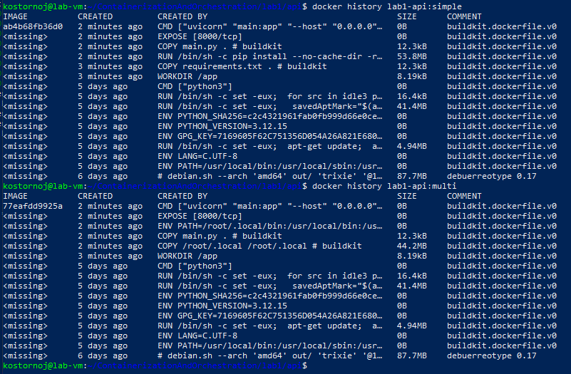

В simple-образе pip install это 53.8 мб, в multi-stage из билдера копируются только пакеты 44.2 мб.
Далее пересобрал без изменений, всё быстро берётся из кэша. Если меняю только main.py,
пересобирается только слой COPY main.py, а pip install кэшированный

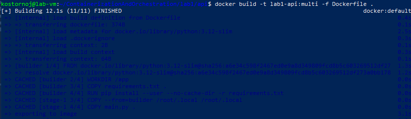

Далее проверил, что файлы без тома не выживают. Написал /app/persist.txt,
удалил контейнер и создал новый, файла нет:

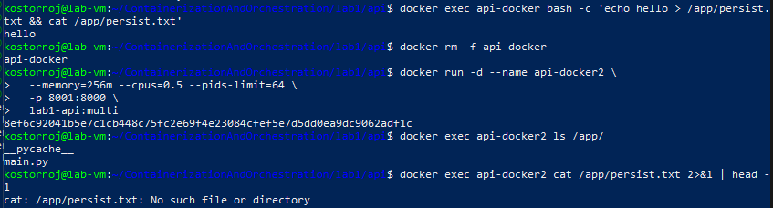

С томом создал lab1-data, смонтировал в /data, опять написал файл,
удалил и создал контейнер и файл оказался на месте:

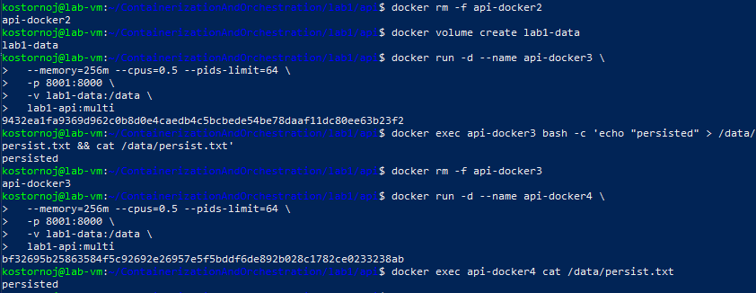

## Часть 7 - gVisor

Установил runsc и зарегистрировал его как Docker runtime:

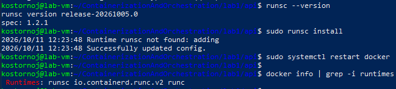

Запускаю тот же образ под gVisor и /health отвечает без изменений в образе:

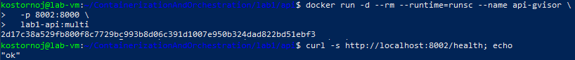

Обычный Docker  шлёт syscalls приложения напрямую в хостовое ядро. Namespaces изолируют видимость,
cgroups - ресурсы, seccomp фильтрует вызовы. Но ядро одно на всех, и если в нём дырка в незаблокированном syscall,
из контейнера можно попробовать вылезти.
gVisor запускает Sentry. Syscalls перехватываются и обрабатываются в юзерспейсе, реальное ядро дёргается редко.
Поверхность атаки сокращается.
Общее у контейнера с хостом - ядро. Это и есть предел: namespaces и cgroups ограничивают доступ,
но не создают отдельный экземпляр ядра.

## Часть 8 - мониторинг

Для сбора метрик использовал cAdvisor, Prometheus и Grafana из стека второй лабы.
В kube-prometheus-stack-values добавил scrape-конфиг на cAdvisor, который крутится в докере на ВМ.

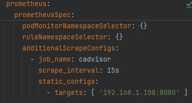

Дашборд с тремя панельками: память, CPU, CPU throttling. В покое память 42.95 МБ константой,
CPU почти 0.5%, throttling 0:

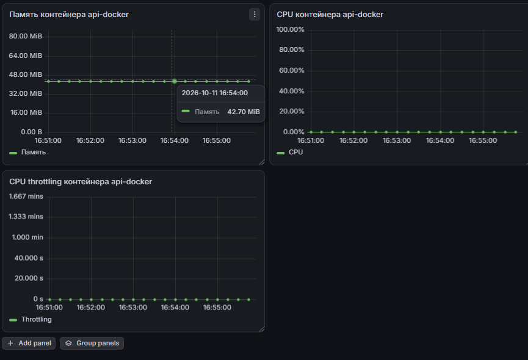

Запустил нагрузку, дёрнул /eat?mb=150 и потом /burn в фоне на 90 секунд:

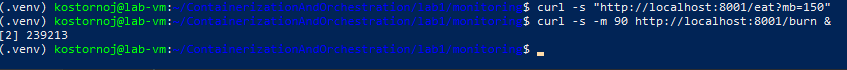

Дашборд под нагрузкой: память подскочила до 192 мб, CPU упёрся в 50% лимита,
throttling постепенно поднялся до примерно 650 ms:

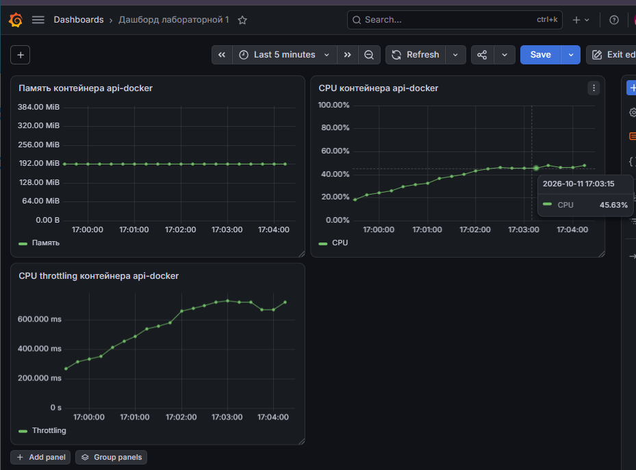

По ходу поймал OOM ещё раз, когда случайно дёрнул /eat?mb=150 дважды (343 мб превысило ограничение 256 мб).
Контейнер умер с ExitCode=137, OOMKilled=true. По сути то же поведение, что в 3 части, только через Docker.

### Алерты

Три метрики, по которым строил бы алерты:
1. Память выше 200 МБ (2 минуты) - ContainerMemoryUsageHigh
  До OOM остаётся примерно 56 МБ. Если не среагировать, то контейнер убьёт OOM-killer,
  сервис пропадёт на несколько минут. Дежурный смотрит логи: если это утечка - увеличить лимит или перезапустить.
2. CPU throttling выше 0.1 с/с (5 минут) - ContainerCpuThrottlingHigh
  Контейнер больше 10% времени за последние 5 минут висел в ожидании CPU. Сервис живой, но отвечает медленнее.
  По error rate такое не видно, поэтому отдельный алерт.
  Дежурный смотрит: если rate(cpu_usage) упёрлось в cpu.max - поднять --cpus.
3. Метрики нет (1 минута) - ContainerDown
  Контейнер пропал из выдачи - упал, остановлен или экспортер его не видит.
  Самый жёсткий вариант: сервис не отвечает вообще. Дежурный смотрит docker ps -a, потом docker logs.

Правила для Prometheus:

```yaml
groups:
  - name: api-docker.rules
    rules:
      - alert: ContainerMemoryUsageHigh
        expr: api_docker_memory_working_set_bytes > 200 * 1024 * 1024
        for: 2m
        labels: { severity: warning }
      - alert: ContainerCpuThrottlingHigh
        expr: rate(api_docker_cpu_throttled_seconds_total[5m]) > 0.1
        for: 5m
        labels: { severity: warning }
      - alert: ContainerDown
        expr: absent(api_docker_memory_working_set_bytes)
        for: 1m
        labels: { severity: critical }
```