# Лаба 7 - Автоматизация devops-процесса с n8n + AI

Лабу делал на ВМ (Ubuntu Server 24.04, 10 ГБ RAM, 12 CPU).

## Часть 1 - кейс

### Контекст

Компания "TaskFlow" - небольшая B2B SaaS-платформа для управления задачами.

Команда 30 разработчиков, 5 человек в поддержке первой линии, 3 сервиса в проде: web, api, worker.

Проблема: в поддержку приходит 50-100 тикетов в день, примерно половина - баг-репорты.

Первая линия разбирает их руками: читает заголовок и описание, пытается понять,
к какому сервису относится проблема, оценивает серьёзность, находит владельца сервиса и назначает.
На один тикет уходит 2-3 минуты, суммарно 2-3 часа в день чисто на сортировку. Рутина без квалификации, но время у людей съедает.

### Кому помогает

- Поддержка первой линии, не надо вручную сортировать, потому что приходит уже разобранный тикет с тегами.
- Разработчики не отвлекаются на дубликаты и получают тикеты с понятным описанием.

### Что делает автоматизация

Триггер: вебхук из системы тикетов (в лабе мокаю curl'ом).

Шаги:
1. Workflow получает JSON тикета: {ticket_id, title, description, reporter}.
2. AI-агент классифицирует тикет: тип (bug/feature/question), сервис (web/api/worker), severity (low/medium/high/critical).
3. Через MCP-filesystem workflow читает документацию сервиса и список открытых issues.
4. AI по этим данным решает, дубликат это, новый баг или не баг вообще.
5. AI генерирует короткое summary для дежурного.
6. Результат кладётся в файл processed/<ticket_id>.json, а ответ возвращается клиенту.

Результат: саппорт получает разобранный тикет с summary и назначением.

## Часть 2 - что должно быть

Чек-лист:

| Требование  | Реализация                                                         |
|-------------|--------------------------------------------------------------------|
| Триггер     | n8n Webhook нода                                                   |
| AI-шаги     | AI Agent нода с Ollama                                             |
| Не-AI шаги  | HTTP Request, MCP Client для чтения/записи файлов                  |
| MCP-серверы | filesystem + memory                                                |
| Toolkit     | read_file, write_file, list_directory, create_entities, read_graph |
| Skills      | в system промте агента                                             |
| Результат   | JSON-файл + ответ на webhook                                       |

### Toolkit

1. read_file - читает файл из /data. Вход: путь. Выход: содержимое. Нужен для чтения документации и списка issues.
2. write_file - пишет файл в /data. Вход: путь, содержимое. Используется для сохранения результата в processed/<ticket_id>.json.
3. list_directory - список файлов в директории. Вход: путь. Пригодился для проверки, что mock-data на месте.
4. create_entities - создаёт сущности в knowledge графе. Вход: список entities с именем и типом. Используется, чтобы сохранить обработанный тикет в память для последующих запросов.
5. read_graph - читает knowledge graph из memory MCP. Вход: пустой. Проверка, что сущность записалась.

### Skills

Правила, по которым действует агент записаны в system промте:

1. Сначала классифицировать тикет и только потом искать owner.
2. Порядок: классификация -> чтение docs -> чтение issues -> решение -> генерация summary.
3. Для багов обязательно проверять дубликаты перед созданием нового issue.
4. Если confidence < 0.7, то добавить пометку needs_human_review.
5. Если Severity не определена, то ставить medium по умолчанию.

## Часть 3 - локальный запуск

### Ollama

Ставлю Ollama на ВМ:

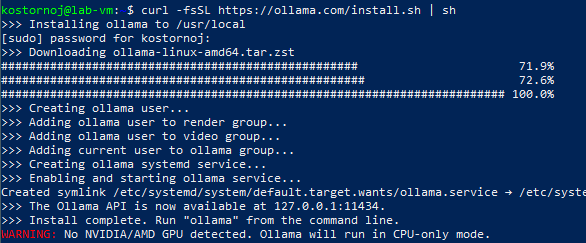

Тяну qwen2.5:3b. Для классификации хватает и такой небольшой модельки:

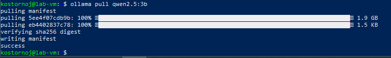

Проверяю, что модель отвечает:

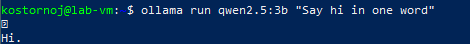

### n8n

Поднимаю n8n в докере:

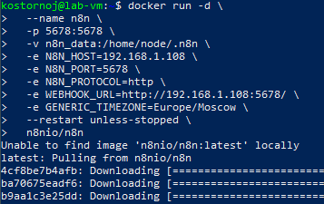

При первом заходе n8n просит создать owner-аккаунт:

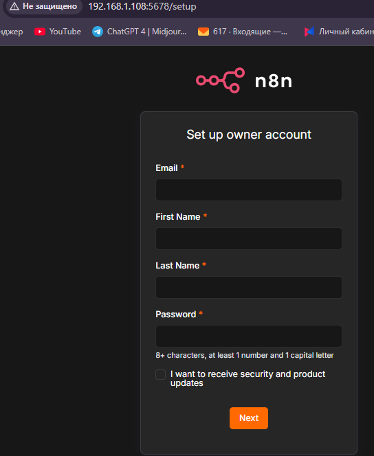

### Mock-данные

Раз настоящей инфраструктуры нет, всё мокаю. В репу положил:

- mock-data/docs/api.md, web.md, worker.md - документация сервисов с именами owner.
- mock-data/issues/open-issues.json - список открытых issues.
- tickets/sample-ticket.json - пример входящего тикета.

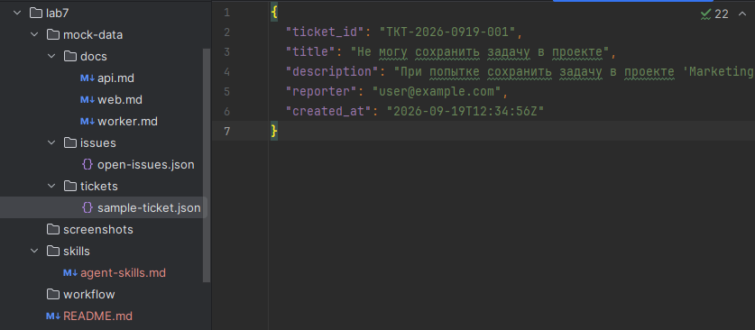

### Ollama креды в n8n

Добавил креды для Ollama:

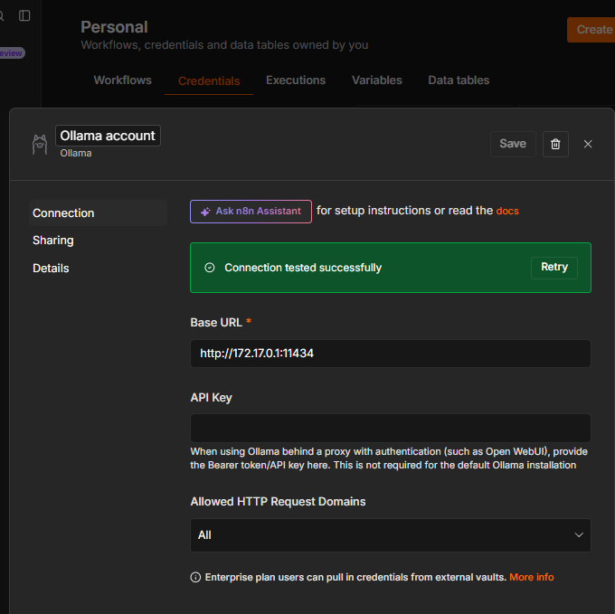

Быстрый тест ноды "Message a Model":

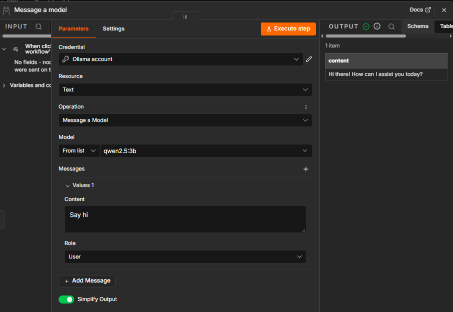

### MCP-серверы и проблема с транспортом

Тут была основная проблемка лабы. По условиям нужно минимум 2 MCP-сервера. Готовые серверы от Anthropic работают по stdio,
а встроенная в n8n нода MCP Client поддерживает только HTTP и прямого способа подключить stdio-MCP к n8n из UI я не нашёл.

Пробовал community-ноду n8n-nodes-mcp, но она тоже только HTTP. Пробовал запускать MCP через npx внутри контейнера n8n.
Процесс стартует, но n8n всё равно не может к нему подключиться без stdio-клиента.

Для решения обернул stdio-MCP в HTTP через пакет mcp-proxy.
Собрал Docker-образ на node:20-alpine, внутри mcp-proxy и оба MCP-сервера.
Поднял два контейнера из одного образа: mcp-filesystem на порту 8081 и mcp-memory на 8082.

Создаю сеть и перезапускаю n8n, чтобы подключить к ней:

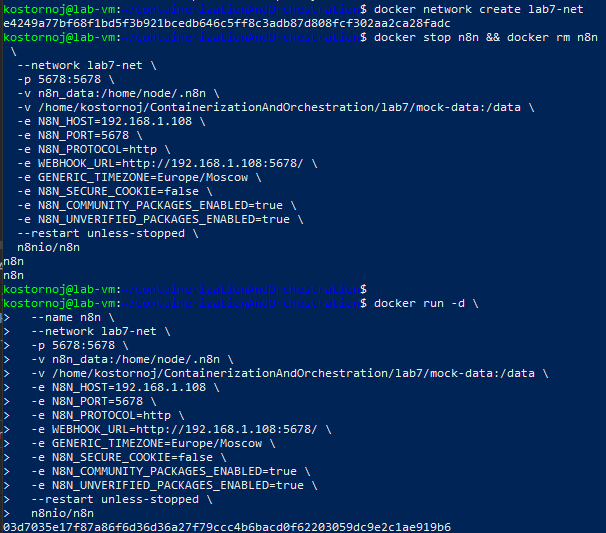

Поднимаю MCP-контейнеры:

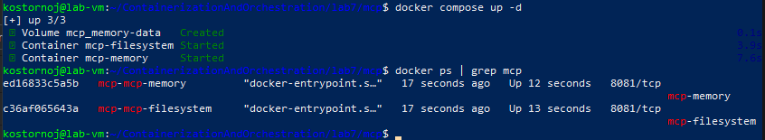

### Проверка MCP

Через ноду MCP Client в n8n дёргаю list_directory на /data.
Вижу три директории: docs, issues, tickets:

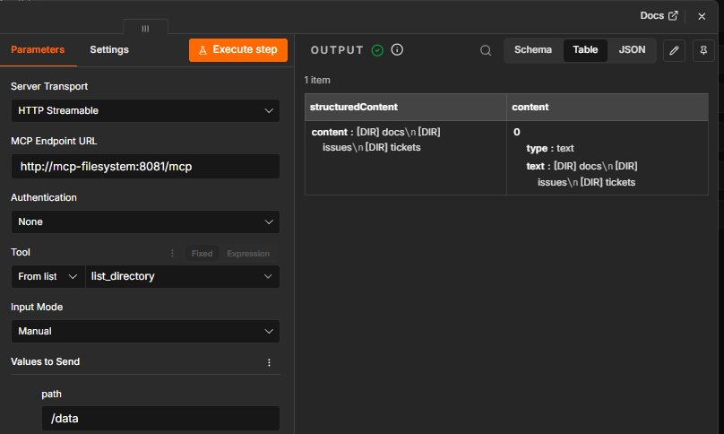

### Workflow

Добавляю Webhook ноду:

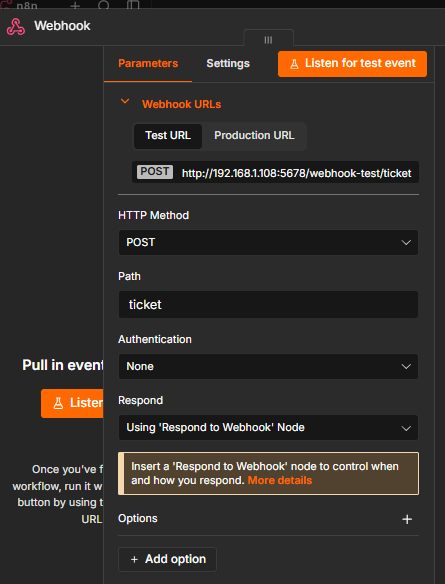

Для AI Agent цепляю Ollama как chat model:

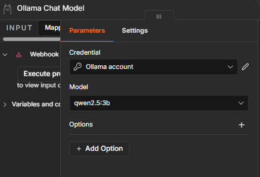

Первая версия workflow была с tool calling, агенту отдавались MCP-серверы как tools, и он сам должен был их дёргать.
С qwen2.5:3b это не заработало, модель зацикливалась и не звала инструменты, а модель помощнее на ВМ запустить не очень вышло.
Поэтому переделал на детерминированный пайплайн: MCP-ноды вызываются явно как обычные ноды, а LLM работает как классификатор.

MCP read docs:

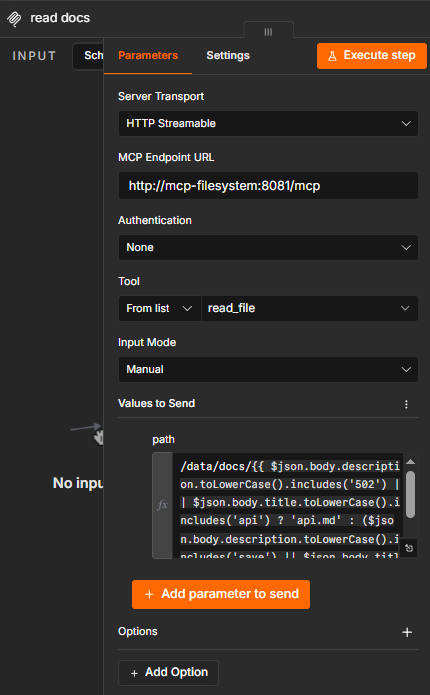

AI Agent - system промт, на вход приходят уже собранные docs и issues:

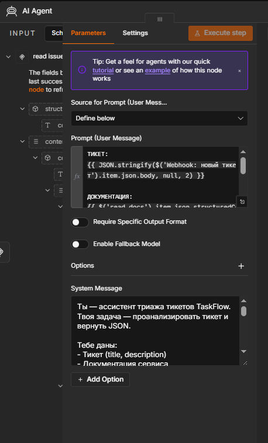

JSON Parser вытаскивает структуру из ответа LLM:

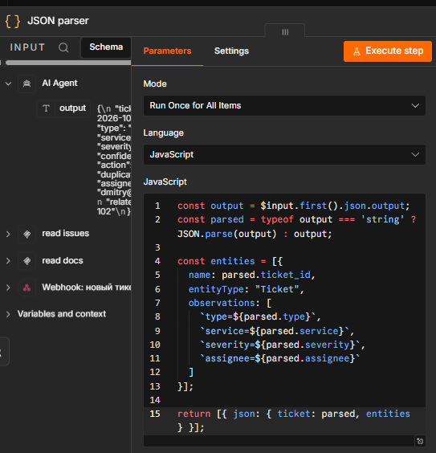

MCP create entities - сохраняет обработанный тикет в memory:

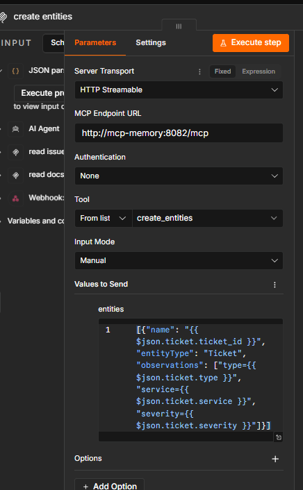

MCP write file - пишет processed/<ticket_id>.json:

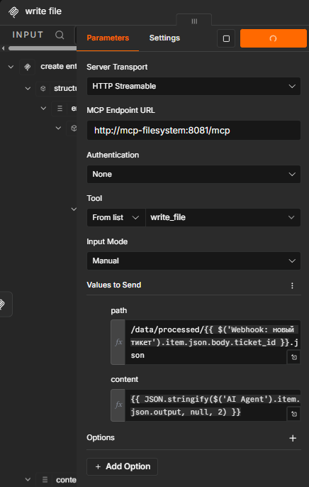

Respond to Webhook:

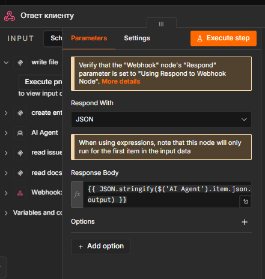

Итоговый Workflow:

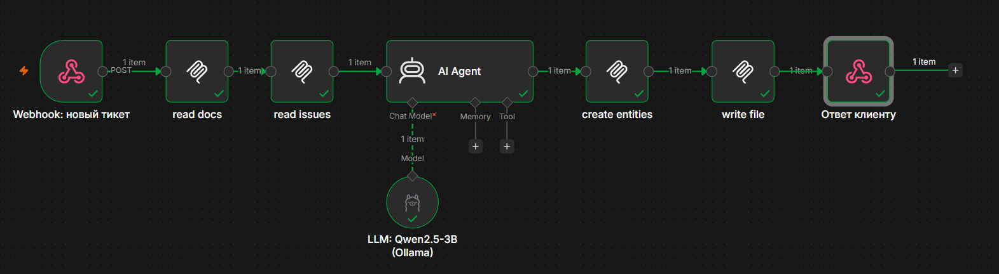

### Рабочий запуск

Дёргаю curl с тикетом про 502 при экспорте отчёта:

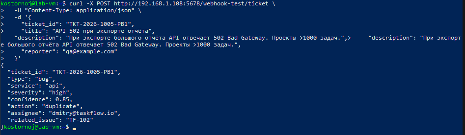

Выход каждой ноды по цепочке:

Read docs:

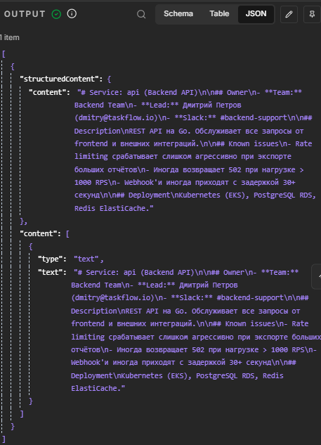

Read issues:

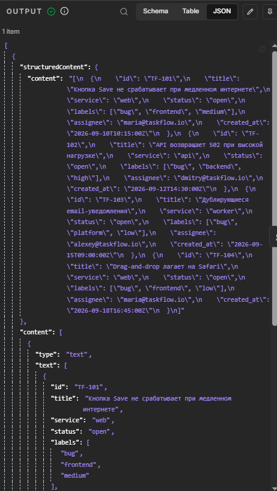

AI Agent - вернул JSON с классификацией:

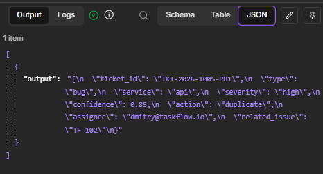

JSON Parser:

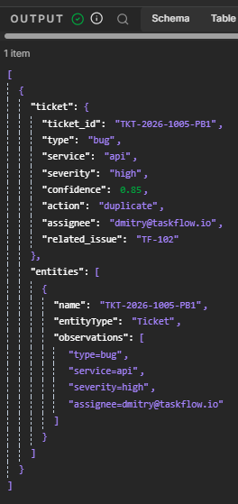

MCP create entities:

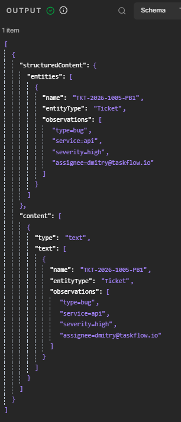

Write file:

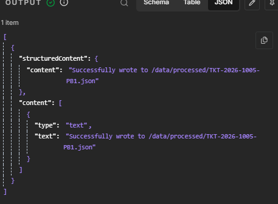

Respond to client:

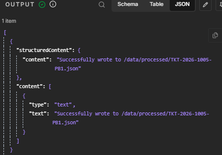

Файл processed/TKT-2026-1005-PB1.json на месте:

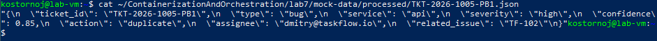

Второй тест - тикет про кнопку Save:

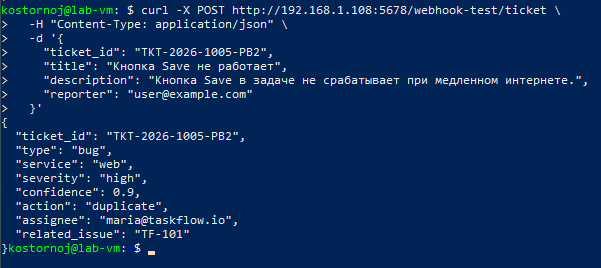

AI Agent вернул классификацию:

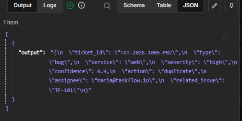

## Часть 4 - мониторинг

n8n сам отдаёт метрики Prometheus по /metrics, поэтому отдельный экспортёр не нужен.
Дашборд с тремя панелями:

P95 времени обработки тикета:

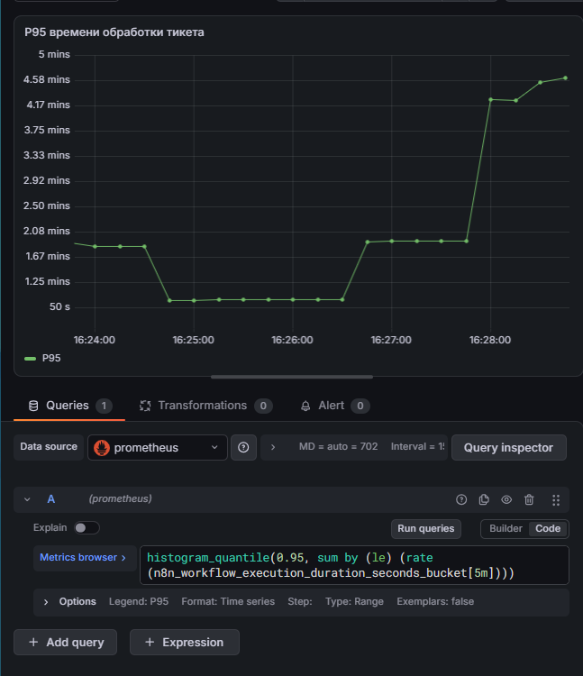

Запусков в секунду по статусу:

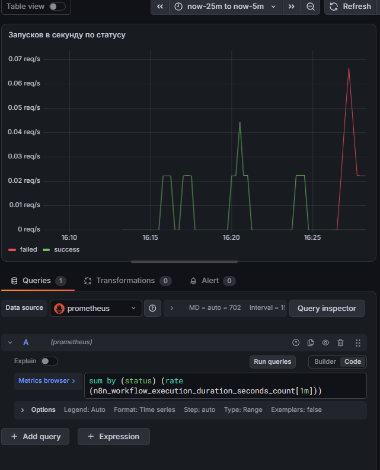

Память n8n:

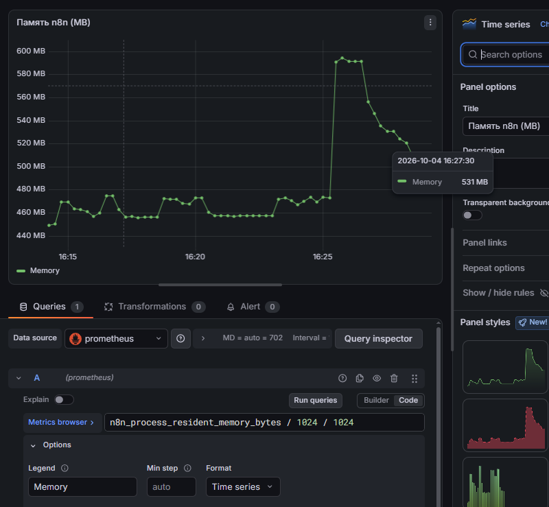

### Три метрики для алертов

1. n8n_workflow_execution_failed_total

Ловит упавшие обработки.
Workflow падает на каком-то шаге: LLM таймаутит, MCP недоступен, парсер не может разобрать ответ.
Грозит тем, что тикеты не обрабатываются и саппорт завален вручную. Дежурный смотрит логи n8n, находит упавший шаг, проверяет доступность LLM и MCP.

2. n8n_workflow_duration_seconds p95

Ловит замедление обработки. LLM тормозит, MCP-сервер завис, приходят большие описания.
Грозит нарушением SLA на реакцию саппорта и накоплением очереди тикетов. Дежурный смотрит latency LLM API, размеры тикетов, нагрузку на MCP.

3. n8n_ai_tokens_total

Ловит аномальный рост расхода токенов. Грозит незапланированными расходами на LLM.
Дежурный проверяет, не приходят ли аномально длинные тикеты и не зациклился ли агент.